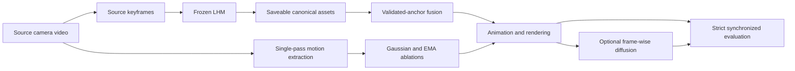

# LHM Monocular Video Temporal Consistency

A recovered URECA prototype with an evidence-first reconstruction and evaluation workflow.

> **Checkpoint 2026-10-26:** source recovery and CPU validation are saved. The new CompShare GPU experiments have **not run yet**. New fusion and camera modules are implementations awaiting end-to-end validation, not established results.

## Evidence available now

| Evidence | Status |
|---|---|
| Recovered poster-v7 source and SHA-256 manifest | Preserved |
| Historical pose jitter 0.128502 → 0.032545 | Confirmed in original run log; historical result |
| Historical translation jitter 0.00132372 → 0.000529604 | Confirmed in original run log; historical result |
| Historical diffusion | Log confirms real img2img restoration of 30/120 frames |
| Duplicated-video bug | Real 60-frame clip reproduced as 120 frames; corrected loader preserves the original 60 frames exactly |
| Strict evaluation validation | Identity sanity check passes; 120-vs-60-frame comparison is rejected |
| Relative-camera algebra | Actual ZJU-313/390 annotations pass 100-point projection checks |
| New GPU quality and performance results | Pending; no new numbers claimed |

**The historical baseline already includes Gaussian smoothing.** Its jitter reduction does not establish improved motion accuracy. The old `drift_trans` metric is endpoint displacement, and the old held-out comparison was not calibrated camera rendering. GaussianAvatar and 3DGS-Avatar are related work, **not reproduced baselines in this repository**.

## Inspect the project

- [Detailed source/report audit](evidence/historical/source_audit_20261026.md)
- [Historical raw run log](evidence/historical/poster_gradio_v7.log)
- [Recovered source manifest](evidence/recovered_source/manifest.json)
- [Frame duplication regression](evidence/frame_duplication_regression.json)
- [Evaluator validation](evidence/evaluator_validation.json)
- [Camera algebra checks](evidence/camera_algebra_checks.json)
- [Headless experiment runner](research/run_experiments.py)
- [Canonical asset and fusion implementation](vendor/LHM/research_assets.py)
- [Mathematical invariant tests](research/test_invariants.py)

## Current experimental scope

The queued workflow covers three retained video segments from two ZJU subjects, motion-filter ablations, five source-keyframe reconstructions, K=2/3/5 fusion comparisons, conservative graph-color refinement, frame-wise diffusion restoration, and a separate calibrated-camera attempt. Every stage writes its configuration, runtime, peak GPU allocation, output paths, and success/failure status. Metrics include full-image and masked PSNR, SSIM, all-frame LPIPS, and temporal differences with explicit units. Per-frame CSVs and error visualizations accompany successful evaluations.

Fusion verifies shared shape and canonical anchor coordinates. Its confidence is a cross-source agreement proxy, not an occlusion estimator. Graph refinement is an inference-time color heuristic. Neither is a trained 3D diffusion model. No unperformed future-work item is reported as completed.

## Reproducibility and attribution

The original local backup is unchanged. The recovered source retains its original notices and licenses under [vendor/LHM](vendor/LHM). The underlying [LHM project](https://github.com/aigc3d/LHM) supplies the pretrained backbone. Model weights and full datasets are not committed. The current snapshot includes tested CPU checks and unvalidated research extensions; it is not a claim of a ready-to-run packaged environment. Dependency failures and environment differences will be documented with the final runs.
