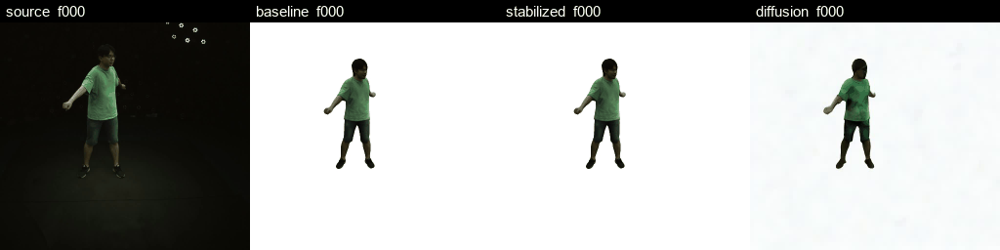
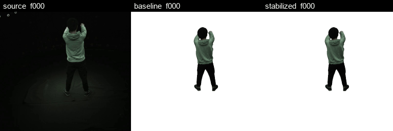
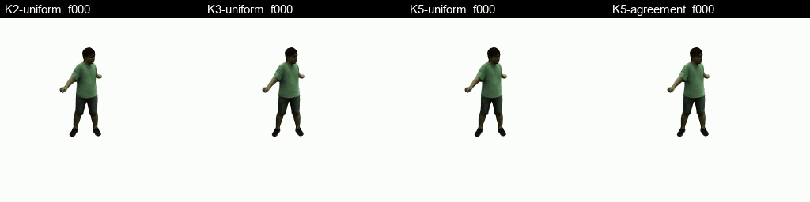
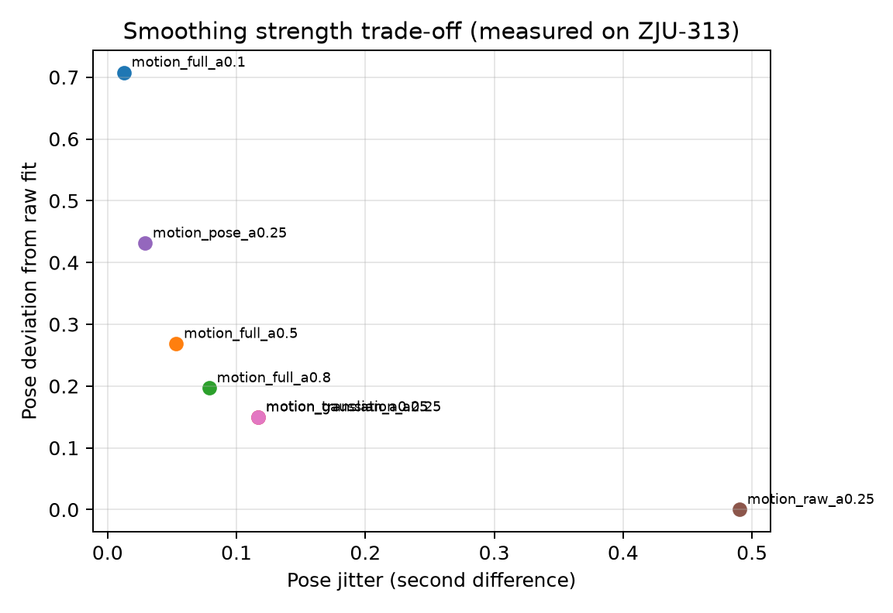
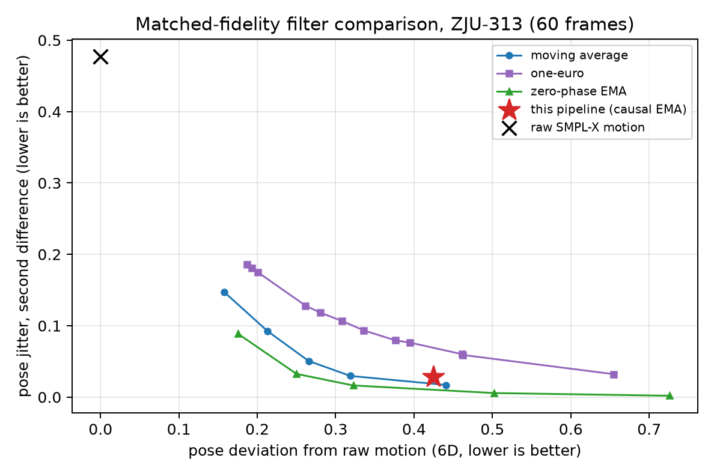

# LHM Monocular Video Temporal Consistency

Recovered URECA prototype: single-image LHM reconstruction driven by a monocular
video, with temporal stabilisation, a strict evaluator, multi-keyframe fusion, and a
calibrated-camera attempt. Everything below was executed on a rented RTX 4090 on
2026-10-27; the raw stage records ship with the repository.

## Headline result

The paper reports pose jitter 0.1285 → 0.0325 (3.95×) and translation jitter
0.0013237 → 0.0005296 (2.50×). The original run had a decoding bug that duplicated
each 60-frame clip into 120 frames; that is fixed here, so absolute values differ but
the **reduction ratios reproduce** on all three retained segments:

| sequence | frames | pose jitter baseline → stabilized | ratio | translation jitter | ratio |
|---|---|---|---|---|---|
| ZJU-313 | 60 | 0.1138 → 0.0283 | **4.03×** | 0.001030 → 0.000412 | **2.50×** |
| ZJU-390 kick | 120 | 0.0623 → 0.0180 | **3.47×** | 0.001100 → 0.000386 | **2.85×** |
| ZJU-390 mid10 | 300 | 0.0860 → 0.0250 | **3.44×** | 0.001050 → 0.000394 | **2.66×** |

## What it looks like

Source video → single-keyframe LHM reconstruction → temporally stabilized →
frame-wise Stable Diffusion restoration:



A second subject (120 frames, kicking motion):



Multi-keyframe fusion, K = 2/3/5 and agreement-weighted (null result, see below):



## Ablation

ZJU-313, second-difference jitter and the deviation it costs:

| variant | pose jitter | trans jitter | pose deviation | geodesic deviation |
|---|---|---|---|---|
| raw fitted motion | 0.4902 | 0.003546 | 0.000 | 0.001° |
| Gaussian prefilter (reported baseline) | 0.1168 | 0.001030 | 0.150 | 0.617° |
| + pose EMA | 0.0283 | 0.001030 | 0.424 | 2.044° |
| + translation-velocity EMA only | 0.1168 | 0.000412 | 0.146 | 0.617° |
| full α=0.10 | 0.0125 | 0.000200 | 0.708 | 3.553° |
| full α=0.50 | 0.0531 | 0.000686 | 0.269 | 1.202° |
| full α=0.80 | 0.0787 | 0.000924 | 0.197 | 0.825° |

Pose EMA supplies essentially all pose-jitter reduction; translation-velocity EMA is
orthogonal and costs no pose deviation; α walks the smoothness/fidelity trade-off.



**One of our own design choices does not survive a matched-fidelity comparison.** At
the same deviation budget, a zero-phase EMA (the same operator run forward and
backward) removes ~2.7× more jitter than the causal EMA this pipeline uses, and a
plain centred moving average also beats it. Offline rendering has no causality
constraint, so the causal filter's lag is pure cost. The comparison, the numbers and
the revised claim are in [reports/04_filter_comparison.md](reports/04_filter_comparison.md).



## Honest results for the "future work" items

| item | status | measured outcome |
|---|---|---|
| Multi-keyframe reconstruction + fusion | **implemented and run** | K=2/3/5, uniform vs agreement-weighted, graph colour refinement: masked PSNR 2.10 → 2.26 dB, within noise — **null result** |
| Reloadable canonical avatar | **implemented** | exact attribute round-trip verified per stage; anchor deviation recorded |
| Frame-wise diffusion restoration | **run** | LPIPS slightly better, temporal delta 1.6–2.8× worse |
| Calibrated camera rendering | **run** | masked PSNR 2.10 → **9.49 dB**, LPIPS 0.826 → 0.687 |
| Trained 3D diffusion / 3DGS-Avatar baselines | **not attempted** | no compute budget for training; not claimed anywhere |

## Why pixel metrics are weak here

The held-out view is a different camera. Rendering from the source camera and
comparing to it gives 0.6–0.9 dB PSNR for every variant — noise. Only the
calibrated-camera render and the motion/temporal metrics carry signal. Full-frame
numbers are still published in `results/gpu_20261027/metrics_table.csv` for
transparency; they are not used as evidence. See
[the results report](reports/03_gpu_experiment_results.md).

## Evidence shipped with the repo

| Evidence | Location |
|---|---|
| 67 stage records, configs, per-stage runtime and peak VRAM | `results/gpu_20261027/stages.json` |
| Metric table (all variants, with block-bootstrap intervals) | `results/gpu_20261027/metrics_table.csv` |
| Motion reproduction per sequence | `results/gpu_20261027/motion_reproduction.csv` |
| Run configuration and GPU identity | `results/gpu_20261027/run_config.json` |
| Figures (PSNR/SSIM/LPIPS/temporal, smoothing trade-off) | `results/gpu_20261027/analysis/` |
| Comparison clips | `figures/compare_*.gif` |
| Historical log and source audit | `evidence/historical/` |
| Recovered-source hash manifest | `evidence/recovered_source/manifest.json` |
| Frame-duplication regression | `evidence/frame_duplication_regression.json` |
| Evaluator validation | `evidence/evaluator_validation.json` |
| CPU preflight and environment freeze | `evidence/cpu_preflight.json`, `evidence/environment_cpu_freeze.txt` |

## Repository layout

```
research/      headless runner, strict evaluator, cameras, fusion helpers, tests
scripts/       environment build, weight download, GPU run wrapper, progress writer
vendor/LHM/    recovered LHM source (original licence and notices retained)
docs/          reproduction guide, input contract, inventory of what is committed
reports/       recovery audit, protocol, GPU results, limits
results/       67 stage records + metric table from the 2026-10-27 GPU run
figures/       figures and comparison clips
evidence/      historical log, hashes, preflight and validation records
```

Start here: [`docs/REPRODUCE.md`](docs/REPRODUCE.md) for the end-to-end procedure,
[`docs/INPUTS.md`](docs/INPUTS.md) for the data contract, and
[`docs/REPO_CONTENTS.md`](docs/REPO_CONTENTS.md) for what is committed versus fetched.

## Reproduce

```bash
git clone https://github.com/Franky5278/lhm-monocular-video-temporal-consistency.git \
  /workspace/lhm/project
cd /workspace/lhm/project

ROOT=/workspace/lhm bash scripts/setup_env.sh        # ~40-60 min, compiles 4 CUDA extensions
ROOT=/workspace/lhm bash scripts/download_models.sh  # 27 GB of weights + SD 1.5
# put the inputs in place, see docs/INPUTS.md

LHM_ROOT=/workspace/lhm /workspace/lhm/env_system/bin/python research/preflight.py
ROOT=/workspace/lhm REPO=/workspace/lhm/project GPU_HOURS=3 bash scripts/run_gpu.sh
python research/analyze_results.py --root /workspace/lhm/results/experiment_v1 \
  --out /workspace/lhm/results/experiment_v1/analysis
```

Every stage writes `stage.json` with status, seconds, peak allocated/reserved VRAM
and config, and re-running skips stages that already succeeded, so an interrupted run
resumes instead of restarting. The 67 stage records of the reference run are committed
under `results/gpu_20261027/stages/`.

## Limits

- Single subject per sequence; no multi-person or occlusion handling.
- Motion is estimated (SMPL-X), not ground truth; deviation is measured against the
  estimate, not against a motion-capture reference.
- Fusion confidence is cross-source agreement, not visibility; refinement is a
  colour heuristic, not a trained diffusion model.
- The calibrated result depends on annotation intrinsics/extrinsics and estimated pose.
- The historical `drift_trans` field was endpoint displacement, not a drift error;
  it is renamed accordingly in this repository.

The original `LHM-run-poster-v7` backup is untouched. Model weights and datasets are
not committed. Upstream: [aigc3d/LHM](https://github.com/aigc3d/LHM).
